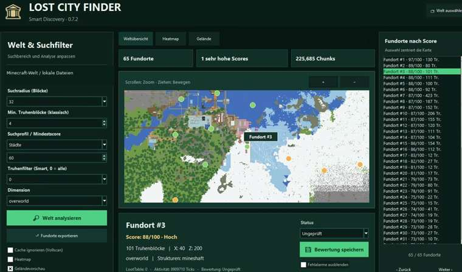

# 🧭 Lost City Finder – Finde deine vergessenen Minecraft-Städte wieder!

**Du hast irgendwann eine Base, ein großes Lager oder sogar eine ganze Stadt in Minecraft gebaut – und findest sie einfach nicht mehr?**

Wer kennt es nicht? Man steckt Stunden in eine kleine oder riesige Base, baut Häuser, Lager und Straßen, fliegt später einmal quer durch die Welt und verliert irgendwann die Orientierung. Vielleicht hat man zwischendurch eine neue Base angefangen, weil die alte einfach nicht mehr auffindbar war. Und selbst wenn man sie nach langer Suche doch noch entdeckt, war es oft reine Glückssache.

Dann geht die Sucherei los: stundenlang über Wälder, Berge und Ozeane fliegen, die Welt kreuz und quer absuchen und nach irgendwelchen Anhaltspunkten Ausschau halten – vielleicht einem Turm, einem besonderen Gebäude oder einer Straße, die man früher selbst gebaut hat. Gerade auf riesigen, über Jahre gewachsenen Welten kann das ganz schön frustrierend werden.

**Genau dieses Problem hatte ich selbst immer wieder.** Ich kannte keine einfache Lösung, mit der ich meine alten Städte zuverlässig wiederfinden konnte. Also kam mir die Idee, selbst ein Tool dafür zu entwickeln: **Lost City Finder**.

Mit dem Lost City Finder kannst du deine gespeicherte Minecraft-Java-Welt durchsuchen und dir Orte anzeigen lassen, an denen sich mit hoher Wahrscheinlichkeit eine alte Base, ein Lager oder eine selbst gebaute Stadt befindet. Ich konnte damit tatsächlich meine lange gesuchten eigenen Städte wiederfinden! 🎉

> **Eine Idee von [tobimachtdas](https://www.youtube.com/@tobimachtdas) – entwickelt mit KI-Unterstützung.** Das Projekt läuft lokal: Deine Minecraft-Welt muss dafür nicht hochgeladen werden.

## 🔎 Wie findet Lost City Finder deine alten Bauwerke?

Die Idee hinter der Suche ist ziemlich einfach: **An Orten, an denen Spieler viel gebaut und gelagert haben, gibt es oft auffällig viele Truhen und weitere Hinweise auf Bauaktivität.** Statt die gesamte Welt von Hand abzufliegen, analysiert das Tool die gespeicherten Weltdateien und sucht solche Stellen automatisch.

1. **Welt auswählen:** Du öffnest eine lokale Minecraft-Java-Welt oder eine Kopie deiner Serverwelt. Der Scanner liest die gespeicherten Regionsdateien.
2. **Truhengruppen erkennen:** Das Tool sucht nach vielen Truhen auf engem Raum. Doppelkisten werden als zwei Truhenblöcke berücksichtigt. Besonders große Lager können starke Hinweise auf eine Spielerbasis sein.
3. **Weitere Merkmale auswerten:** Baumaterialien, Aktivitätsdaten gespeicherter Chunks und Hinweise auf natürlich generierte Strukturen fließen in die Bewertung ein.
4. **Fundorte bewerten:** Jeder Kandidat erhält einen **Erkennungsscore**, damit du interessante Orte priorisieren kannst. Das ist eine Orientierungshilfe – **keine mathematisch garantierte Wahrscheinlichkeit** und kein sicherer Nachweis, wer dort gebaut hat.
5. **Nahe Treffer zusammenfassen:** Besonders wichtig ist die **Fernsuche mit einstellbarem Mindestabstand**. So werden nicht zehn Häuser derselben Stadt als zehn voneinander unabhängige Städte angezeigt. Für weit entfernte Siedlungen kannst du den Mindestabstand deutlich erhöhen.
6. **Auf der Karte überprüfen:** Eine zoombare Geländeansicht zeigt die gespeicherte Landschaft und mögliche Gebäude. So kannst du viel schneller einschätzen, ob du den gesuchten Ort wiedererkennst.
7. **Wieder hinfinden:** Du kannst die Fundorte als `locations.json` exportieren. Mit dem optionalen **Lost City Navigator** auf einem Paper-Server wählst du Ziele im Spiel aus und lässt dich per Kompass dorthin führen – mit entsprechender Berechtigung auch per Teleport.

### 🧰 Was kann das Projekt?

| Desktop-App: Lost City Finder | Server-Plugin: Lost City Navigator |
| --- | --- |
| Lokaler Welt-Scan ohne Cloud | Zielauswahl im Minecraft-Inventar |
| Truhenerkennung und Erkennungsscore | Navigationskompass und Entfernungsanzeige |
| Fernsuche mit großem Mindestabstand | Übersicht der Fundorte in der Sidebar |
| Geländeansicht, Heatmap und Fundortliste | Zielwechsel und optionaler Teleport |
| SQLite-Cache für spätere Scans | Rechte für Spieler und Administratoren |
| JSON-Export für den Server | Import der gefundenen Orte |

➡️ **[Desktop-App, Screenshots und Startanleitung](desktop-app/)**  
➡️ **[Paper-Plugin: Installation und Befehle](#bedienung)**

## ❤️ Weitere kostenlose Projekte von tobimachtdas

Wenn du Lust auf weitere Minecraft-Tools, kleine Apps, lokale KI-Projekte und Vibe-Coding-Experimente hast, würde ich mich riesig freuen, wenn du auf meinem YouTube-Kanal vorbeischaust. Vielleicht ist auch das nächste Projekt etwas für dich!

🎬 **[YouTube: Tobi macht das (@tobimachtdas)](https://www.youtube.com/@tobimachtdas)**

Auf meinem Kanal kannst du verfolgen, wie ich neue Software-Ideen umsetze. Ich möchte auch künftig immer wieder **kleinere Projekte kostenlos anbieten und hier auf GitHub veröffentlichen**. Wenn dir Lost City Finder hilft, freue ich mich sehr über ein Abo, einen Kommentar oder eine Empfehlung. Danke für deinen Support! ❤️

---

## 🧩 Lost City Navigator – Paper-Plugin 0.9.3

## Was ist neu?

- **Rechte Minecraft-Sidebar**: zeigt das ausgewählte Ziel, Distanz sowie bis zu fünf nahe Fundorte aus der aktuellen Dimension. Ein-/ausblenden mit `/lostcity map` oder über das Navigator-Menü. Technisch ist es ein Scoreboard, **noch keine grafische Geländekarte**. Die Sidebar übernimmt nur die Anzeige, solange keine andere Plugin-Sidebar gesetzt wurde.
- **Navigator-Menü**: Rechtsklick mit dem Spezialkompass oder `/lostcity list`. Bis zu 36 Ziele pro Seite, Navigation mit den Papier-Buttons in Slot 8 und 9.
- **Ziel wechseln**: Klick auf einen Fundort, Schaltflächen Vorheriges/Nächstes oder `/lostcity prev` und `/lostcity next`.
- **Teleport**: Ziel auswählen und im Menü auf die Enderperle klicken oder `/lostcity tp` ausführen. **Standardmäßig nur für OPs** (`lostcity.teleport`). Das Plugin sucht einen freien Oberflächenpunkt nahe den Fundkoordinaten; findet es keinen, wird der Teleport abgebrochen. Der Punkt ist nicht garantiert gefahrlos – unbedingt zunächst auf einer Testwelt ausprobieren.
- **Berechtigungen**: `lostcity.use` (alle), `lostcity.admin` (OP), `lostcity.teleport` (OP). Nicht freigegebene Fundorte bleiben privat.
- **config.yml**: Sidebar ein-/ausschaltbar; Teleport global deaktivierbar; optional Dimensionen konkreten Welt-Namen zuordnen.

## Bedienung

`/lostcity compass` – Navigator erhalten  
`/lostcity list` – Fundortauswahl öffnen  
`/lostcity map` – rechte Übersicht umschalten  
`/lostcity next` / `/lostcity prev` – anderes Ziel  
`/lostcity tp` – zum ausgewählten Ziel teleportieren (OP)  
`/lostcity reload` – `locations.json` neu laden (OP)

**Hinweis:** Die Liste in der rechten Sidebar dient nur zur Übersicht. Einträge einer Minecraft-Scoreboard-Sidebar sind nicht anklickbar. Fundorte wechselst du mit dem Navigator-Menü bzw. den Befehlen.

## Paper-JAR über GitHub Actions bauen

1. ZIP entpacken.
2. Inhalt ins bestehende GitHub-Repository hochladen und die Dateien `pom.xml`, `src/main/java/de/lostcity/LostCityNavigator.java`, `src/main/resources/plugin.yml` und `.github/workflows/build-paper.yml` ersetzen; `src/main/resources/config.yml` hinzufügen. Der Inhalt muss **direkt im Repo-Stamm** liegen.
3. Nach dem Commit **Actions → Build Lost City Navigator (Paper 1.21.8)** öffnen.
4. Den erfolgreichen Lauf öffnen und unter **Artifacts** die JAR herunterladen.
5. Auf einer Testkopie des Paper-Servers alte Navigator-JAR entfernen, neue JAR installieren und Server neu starten.
6. Bereits vorhandene `plugins/LostCityNavigator/locations.json` und deine Fundortdaten beibehalten.

Die JAR wird gegen die **echte Paper 1.21.8 API** gebaut; keine nachgebauten Bukkit-Stubs. Der Build ist hier nicht ausgeführt worden, da die Paper-API / Maven in dieser Laufzeit nicht verfügbar sind. Ein echter Paper-Servertest steht ebenfalls noch aus.

## Sicherheit

Das Plugin ist nur für deine eigene oder ausdrücklich freigegebene Serverwelt vorgesehen. Private Ziele werden normalen Spielern nicht angezeigt und Standardspieler dürfen sich nicht teleportieren. Vor dem ersten Test Serverbackup anfertigen. Wenn du andere Scoreboard-Plugins verwendest, blendet der Navigator seine Sidebar zurückhaltend aus, statt deren Anzeige zu überschreiben.

---

## Desktop-App und Quellcode

Die lokale Desktop-App inklusive Scanner, Karte, Fernsuche und Build-Anleitung findest du unter **[desktop-app/](desktop-app/)**. Der Plugin-Quellcode befindet sich im Repository-Hauptverzeichnis.
