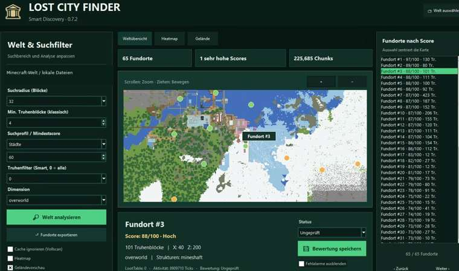

# Lost City Finder – Desktop-App

**Eine Idee von [tobimachtdas](https://www.youtube.com/@tobimachtdas), umgesetzt mit KI-Unterstützung.**

Lokales Minecraft-Java-Weltanalysewerkzeug: Truhengruppen, intelligente Bauwerkerkennung, große Städte mit Abstandssuche, Geländeübersicht und Export für den Lost City Navigator auf Paper-Servern.

*Echter Screenshot der klassischen Desktop-Oberfläche (Version 0.8), aus Datenschutzgründen mit verdecktem lokalen Weltpfad. Das neue Web-/Tauri-Frontend kann optisch abweichen.*

## Struktur

- `desktop/` – Python-Scanner, Webserver, SQLite-Cache und klassische Desktop-Oberfläche
- `frontend/` – Web-/Tauri-Benutzeroberfläche
- `src-tauri/` – native Tauri-Hülle und Programm-Icon
- `tests/` – Tests aus dem Desktop-App-Paket
- `build_windows.ps1` – Windows-Build für Portable-EXE und Tauri-Installer
- `HISTORY.md` – ursprüngliche Entwicklungsnotizen und Bedienhinweise

## Lokal starten (Windows)

Benötigt: Python 3.10+ (für die Browser-Oberfläche).

1. Repository herunterladen oder klonen.
2. Unter `desktop-app/` die Datei `start_web_windows.bat` ausführen.
3. Die Browser-Oberfläche öffnet sich lokal. Deine Weltdateien werden nicht an einen Cloud-Dienst übertragen.

Alternativ startet `desktop/start_windows.bat` die bisherige Tkinter-Desktop-App.

## Windows-EXE bauen

Auf GitHub unter **Actions → Desktop Windows EXE and Installer → Run workflow** einen Windows-Build starten. Die Ergebnisse sind danach als GitHub-Action-Artefakte verfügbar, **sofern der Build erfolgreich ist**.

Auf einem Windows-Entwicklungsrechner stehen außerdem `build_windows.bat` und `build_windows.ps1` bereit. Für den Build sind Python 3.12, Rust/Cargo und gegebenenfalls Windows C++ Build Tools nötig; **Endnutzer sollen diese Entwicklungswerkzeuge nicht installieren müssen**.

Der Tauri-Build ist weiterhin eine Entwicklerversion und muss noch auf Windows getestet werden. Eine fertige, bereits verifizierte EXE ist hier nicht enthalten.

## Paper-Plugin

Das aktuelle Paper-Plugin liegt separat im **Repository-Hauptverzeichnis** (`pom.xml`, `src/`). Seine Maven-/GitHub-Actions-Builds bleiben unabhängig von der Desktop-App.

Die Desktop-App exportiert `locations.json`. Auf dem Paper-Server kommt diese Datei nach `plugins/LostCityNavigator/locations.json`; danach `/lostcity reload`.

## Datenschutz

Bitte niemals Minecraft-Weltordner, `locations.json` aus privaten Welten, Cache-Datenbanken oder Zugangsdaten in das öffentliche GitHub-Repository einchecken.
